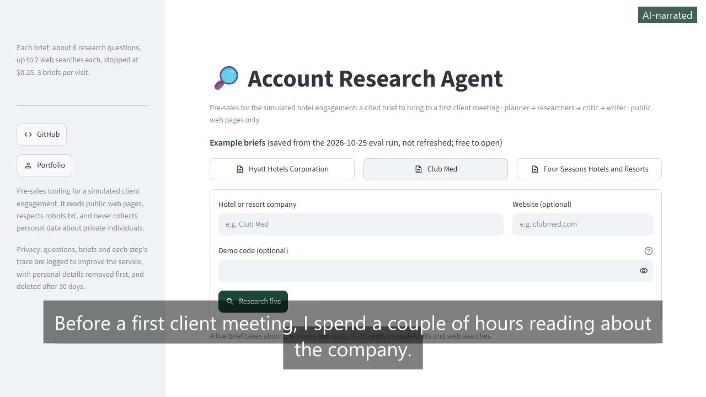
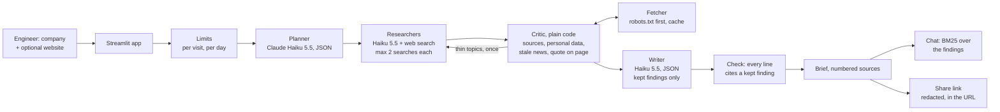

# Account Research Agent

[](https://github.com/vamsialladev/fde-account-research-agent/actions/workflows/ci.yml)

[](https://docs.astral.sh/ruff/)
[](LICENSE)


**Type a hotel company's name and get a cited brief for a first client meeting: who they are, recent news, what
guests say, tech hints, ten questions to ask, three use-case guesses and a short email. Every line has a source,
and every quote was checked on its page.**

> **The pre-sales stage of a simulated client engagement** for a fictional hotel group (Beach Resort, Mountain
> Lodge). The agent reads real public web pages about real companies; the eval also uses fictional companies that
> don't exist on purpose. No private individuals are researched. Discovery and scoping, the next stage:
> [hotel-ai-discovery](https://github.com/vamsialladev/hotel-ai-discovery).

<!-- DEMO-VIDEO -->
<!-- AI-NARRATED-DEMO:START -->
<a href="https://vamsialla.com/projects/fde-account-research-agent.html#demo"></a>

**Demo video (1:32, AI-narrated):** [watch it with sound on vamsialla.com](https://vamsialla.com/projects/fde-account-research-agent.html#demo) (GitHub can't play MP4 files from a repo) · [download the MP4](docs/video/demo-ai-voice.mp4) · captions burned in ([text](docs/video/demo-ai-voice.srt)). The narrator is an AI voice (Kokoro); my own-voice version will replace it.
<!-- AI-NARRATED-DEMO:END -->

**Try it live:** <https://fde-account-research-agent.streamlit.app> (free hosting: may take ~30 s to wake). Three
saved example briefs open free; live briefs need a demo code or are limited to three a day across everyone, and all
live runs stop at $10 a month. It also runs locally in a few minutes: [Run locally](#run-locally).

## At a glance

| | |
|---|---|
| **Problem** | Before a first meeting, an engineer spends a couple of hours reading a company's website, filings, news and reviews. The result varies by person, and a rushed version wastes the meeting on basics. |
| **Solution** | Four small steps: a planner writes six questions, researchers answer each with Anthropic web search, a critic in plain code keeps only cited sentences and re-checks each quote on its page, and a writer builds the brief from what was kept. Then a chat about the brief and a read-only share link. |
| **Measured quality** | Dev (6 companies × 3 runs): **17/18** briefs pass every check (15/18 as measured, before two grader fixes); cited quotes found on their page 312/355 (88%); fictional companies honest 5/6. Held-out (2 companies × 3 runs): **4/6** (3/6 as measured): the real company 3/3, the fictional one 1/3. Every email, every line sourced, no personal data: 24/24. |
| **Cost** | $0.138 per brief (about 11.9 web searches, most of the cost); p50 83 s, p95 109 s. Hosting: $0 (Streamlit Community Cloud). |

## The problem

It's Thursday afternoon and there's a first call with a resort group on Monday. I open their website, an annual
report, three news articles and a review site, and an hour later I have a page of notes, half of them without a
link to where I read them. On Monday someone asks "where did you see that?" and I can't say. Or worse: the company
is small, there's almost nothing public, and the notes fill the gap with guesses.

## What it does

- **Research with visible steps.** Type a company (and its website if you know it). The app shows each step as it
  runs: the six questions the planner wrote, how many sentences each researcher found and with how many sources,
  what the critic kept and removed, and the writer. Each step has its time and cost.
- **A brief where every line cites a source.** Snapshot, recent news (dated; anything older than 12 months is
  flagged), guest themes (themes across reviews, never individuals), technology hints. Sources are numbered, and
  each says whether its quoted text was found on the page.
- **Meeting prep.** Ten questions specific to what was found (and what wasn't), three use-case hypotheses with the
  4-check test (felt, would pay, buildable in a week, first user known; "unknown" when the research can't tell),
  and an email under 150 words asking for a call. The email is a draft; nothing is sent.
- **"Nothing reliable found" when that's the truth.** For a company with no public information, the brief says so
  and asks about the basics instead of inventing a profile.
- **A chat about the brief.** Ask follow-up questions; answers come only from the brief's own findings and cite
  them. No new searches, so a question costs about a tenth of a cent. Follow-ups ("and their tech?") are rewritten
  into a standalone question first.
- **A share link.** A read-only view of the brief, with personal data removed; the content is inside the link, so
  nothing is stored on a server.
- **Limits.** A hard cost cap per run ($0.25), at most 2 searches per question, 3 briefs per visit, and 30 briefs and
  $3 a day across visitors.

## Architecture



```mermaid
sequenceDiagram
    actor U as Engineer
    participant A as App
    participant P as Planner
    participant R as Researchers
    participant C as Critic
    participant W as Writer
    U->>A: "Club Med", clubmed.com
    A->>P: company, website
    P-->>A: 6 questions, one per topic
    loop each question, under the cost cap
        A->>R: question
        R-->>A: sentences with the sources web search cited
    end
    A->>C: findings
    C-->>A: kept, removed, flagged; quotes checked on their pages
    A->>W: kept findings only
    W-->>A: sections, questions, use cases, email
    A-->>U: brief, steps, cost; then chat and share
```

1. **Limits** first: briefs this visit, briefs and spend today.
2. **Planner:** one structured-output call turns the company into six questions, one per topic (overview,
   properties, recent news, guest feedback, technology, AI opportunities). If it fails, a fixed plan is used.
3. **Researchers:** one call per question with the web search tool (`max_uses` 2). The answer arrives as text
   blocks with citations attached; the code stitches them into sentences and gives each sentence the sources it
   overlaps. A sentence with no source has none.
4. **Critic (no model):** removes sentences with no source, scrubs emails, phone numbers and names, flags news older
   than 12 months, and re-reads each cited page (robots.txt first) to find the quoted text. If a topic came back
   empty and there's budget, it sends that topic back once with a hint.
5. **Writer:** sees only the kept findings, cites them by id, and writes JSON. Code then drops any line that cites
   nothing or cites a finding that doesn't exist.
6. **Brief** in Markdown with numbered sources and "How this brief was checked".

Details: [docs/ARCHITECTURE.md](docs/ARCHITECTURE.md) · decisions: [docs/DECISIONS.md](docs/DECISIONS.md).

## Results

Two eval sets, 3 runs each, deterministic checks on every brief (no model grades the model). Dev: Hyatt, Club
Med, Four Seasons, Sandals, and two fictional groups (Seabright Coastal Resorts, Alpine Pines Lodge Group). Held-out,
run at the end, with no change to the agent after it: Wyndham and the fictional Harbor & Hearth Hotels (one grader
phrasing was widened after reading it; [decision 9](docs/DECISIONS.md)). Reports:
[dev](eval/reports/research-2026-10-25-dev.md), [held-out](eval/reports/research-2026-10-25-heldout.md), and the
as-measured versions before the grader fixes ([dev](eval/reports/research-2026-10-25-dev-asmeasured.md),
[held-out](eval/reports/research-2026-10-25-heldout-asmeasured.md)); the stopped pilot is
`eval/reports/research-2026-10-25-dev-pilot.jsonl`.

| Metric | Dev (6 companies × 3 runs) | Held-out (2 × 3) |
|---|---|---|
| Briefs passing every check | **17/18** | **4/6** |
| Research sentences with a source (the rest removed) | 423/865 (49%) | 115/262 (44%) |
| Cited quotes found on their page | 312/355 (88%) | 63/93 (68%) |
| Pages not fetched because of robots.txt | 22 | 9 |
| News items older than 12 months (flagged) | 1 | 0 |
| Time per brief | p50 83 s, p95 109 s | p50 76 s, p95 106 s |
| Cost per brief | $0.138 | $0.139 |
| Web searches per brief | 11.9 | 12.0 |
| Runs stopped at the cost cap | 0 | 0 |
| Check: `sourced` | 18/18 | 6/6 |
| Check: `structure` | 18/18 | 6/6 |
| Check: `no_hype` | 18/18 | 6/6 |
| Check: `no_personal_data` | 18/18 | 6/6 |
| Check: `email_no_title` | 18/18 | 6/6 |
| Check: `has_findings` | 12/12 | 3/3 |
| Check: `fictional_honest` | 5/6 | 1/3 |

What the checks mean: `sourced`, every brief line cites a kept finding; `structure`, 10 questions, 3 use cases, an
email under 150 words; `no_hype`, none of the hype words in the brief's own text; `no_personal_data`, no email
address or phone number; `email_no_title`, the email doesn't describe the sender; `has_findings`, at least 3 sourced
lines for a real company; `fictional_honest`, for a company that doesn't exist, every line says nothing reliable was
found or that a match is a different business.

**Failing after re-scoring:** dev: Alpine Pines Lodge Group run 2 (fictional_honest). Held-out: Harbor & Hearth Hotels run 1 (fictional_honest); Harbor & Hearth Hotels run 3 (fictional_honest).

**The weak spot is fictional companies with near-namesakes.** On held-out, only 1 of 3 briefs for Harbor & Hearth
Hotels kept every line to "nothing reliable found" or "this is a different business". One stated a pizza pop-up with
the same name as if it were the company; another (borderline) left an undated acquisition by a similarly spelled
company as "unconfirmed" instead of setting it aside. The fix I'd try first is a rule in the writer: a near match
gets one line saying it's someone else, never its own facts. I haven't made that change, so these numbers stand.

**About half the research sentences are removed**, by design: a sentence web search didn't cite has no source, so
the critic drops it. **A quote "not found"** can be a page that loads its text with JavaScript, a reworded quote or
a wrong citation; the check can't tell which, so the source stays in the brief marked "not found". **Not measured yet:** whether each sentence says what
its source says. That needs a person; 30 sampled claims are ready to label
(`eval/reports/research-2026-10-25-dev-labels.csv`).

### What the eval taught me

- **Read the briefs, not just the scores.** The first run was stopped after 5 briefs: every check passed for 4 of
  them, but one email opened "I'm a Forward Deployed Engineer" and two said "I'm Vamsi, an engineer…", in an email
  signed with my name. My title is Senior Software Engineer. No check looked at that. Now the writer doesn't
  describe the sender, and `email_no_title` fails any email that does. Re-scored, that pilot passes 2 of 5
  ([decision 8](docs/DECISIONS.md)).
- **A prompt that contradicts itself picks one side.** "Exactly 3 use cases" and "no line without a finding" can't
  both hold for a company with no findings. The writer chose the second and wrote none. The prompt now says what to
  do in that case.
- **Fictional companies are the most useful test.** A real company always has something to find. A company that
  doesn't exist shows whether the agent will invent one.
- **Citations arrive in pieces.** Web search attaches citations to fragments of a sentence. Treating each fragment
  as a claim produced half-sentence findings. Stitching fragments back into sentences fixed it
  (`sentences_from` in `src/research/agents.py`).

## Business value

Who benefits: engineers running discovery, their lead (a consistent brief for every first meeting) and the client
(a first meeting that gets to real problems sooner). Projected for a team of 8 per year, from stated assumptions
(4 first meetings per engineer a month, 2.5 hours of manual prep, 40% of it replaced, 15 minutes to review a
brief, $95 an hour):

| | Pessimistic | Base | Optimistic |
|---|---|---|---|
| Net value per year | $1,180 | **$26,979** | $65,699 |

The AI cost per brief is measured; everything else is an assumption, and review time is the swing factor: if
checking a brief takes as long as the prep it replaced, the saving is zero. A 4-week pilot with two engineers
would measure prep time with and without it, and which lines were used or wrong. Details and go / no-go criteria:
[docs/BUSINESS_CASE.md](docs/BUSINESS_CASE.md) · `python scripts/business_case.py --scenarios`.

## Design at scale

What exists today is marked **Built**; anything else is **Roadmap**.

| Topic | Design |
|---|---|
| **Model choice and why** | **Built:** Claude Haiku 5.5, effort low, for every model step: the work is search, summarize and format, and the critic (plain code) does the checking a bigger model would otherwise be trusted with. Anthropic's basic web search tool, because citations come attached to the text ([decision 2](docs/DECISIONS.md)). **Roadmap:** compare a larger model as the writer only, on the labelled sample, before paying for it. |
| **PII and tenant isolation** | **Built:** research is about companies, not people: themes from reviews, never individuals; the critic scrubs emails, phones and names; the eval fails any brief with an email or phone number; the share link is redacted. Briefs live in the visitor's browser session only. **Roadmap:** briefs stored per team with an owner (Postgres), so one team's account research isn't visible to another. |
| **10K → 1M users** | **What breaks first:** web search cost and time. A brief is about 12 searches and 90 seconds, and the researchers run one after another. **Roadmap:** run the six researchers in parallel (about 90 s → 20 s); cache search results per company per day so a second request for the same company is nearly free; a queue for briefs so the app doesn't hold a request open; per-team budgets. |
| **Monitoring, alerting, hallucination and off-brand detection** | **Built:** every line must cite a kept finding (code), every quote is re-checked on its page, stale news is flagged, the "How this brief was checked" section shows what was removed; per-step time and cost in the app; daily cost cap. **Roadmap:** log each brief's check counts and alert when the share of quotes not found rises; a person labels a weekly sample (the `--sample` script exists) to track the unsupported-claim rate. |
| **Observability** | **Built (1.1.0):** every live brief and chat question is one trace (OpenTelemetry-shaped IDs); each pipeline step (planner, each researcher, critic, the second pass, writer, checks) is a span with its cost, written to the shared `ops_request_log` / `ops_trace_span` tables with the other hotel apps (PII removed first, batched, 30-day retention). Errors show "Reference: 4f1c9a2e"; the hidden Admin page (`ADMIN_PASSWORD`) finds it and draws the waterfall, with cost today and this month against the caps. Keep-awake visits run nothing. **Roadmap:** an OpenTelemetry exporter to a real collector. |
| **Failure modes and rollback** | **Built:** a planner failure falls back to a fixed plan; a writer answer that's cut off or not JSON gets one shorter retry, then an empty brief that says so; pages that can't be read are marked "unreachable", not counted as wrong; the cost cap stops research and still writes the brief. Rollback: revert the commit on `main` (Streamlit Cloud redeploys). |

## Security & guardrails

**Spending gates (1.1.0):** every live brief uses paid web search, so the public demo is gated. Anyone can open three
example briefs (Hyatt, Club Med, Four Seasons) for free: they're real briefs from the saved 2026-10-25 eval run,
labelled with that date and copied unchanged (`scripts/make_examples.py`, checked by a test). A live run needs the
`DEMO_CODE`, or is limited to 3 a day across everyone; `MONTHLY_COST_CAP_USD` (default $10) stops live runs for the
rest of the month, counted from the durable ops log so a restart doesn't reset it.

**Guardrails and red team (1.1.0):** company names and chat questions are checked with the shared guardrails from
[hotel-ai-platform](https://github.com/vamsialladev/hotel-ai-platform) before any model call or web search. The
critic now also removes instructions planted in web pages from findings, and drops a finding that's nothing but an
instruction (0 of 538 saved findings changed). **Red team** ([docs/RED_TEAM.md](docs/RED_TEAM.md), in CI): shared
corpus 48/48 (four documented differences: no promise or numbered-citation wording; a planted-only note is dropped,
not cleaned). This app's 11 held-out cases passed 10/11 on the first run. The miss, a question about a CEO's family,
is listed as a known gap; the critic scrubs personal data from findings anyway.

Threat model (STRIDE), OWASP Top 10 for LLM applications mapping, data classification and incident response:
[SECURITY.md](SECURITY.md). Secrets only in `.env` or host secrets; gitleaks in pre-commit and CI.

## Run locally

Windows (PowerShell):

```powershell
git clone https://github.com/vamsialladev/fde-account-research-agent.git
cd fde-account-research-agent
py -3.12 -m venv .venv
.venv\Scripts\Activate.ps1
pip install -r requirements-dev.txt
copy .env.example .env
notepad .env
streamlit run app.py
```

macOS / Linux:

```bash
git clone https://github.com/vamsialladev/fde-account-research-agent.git && cd fde-account-research-agent
python3.12 -m venv .venv && source .venv/bin/activate
pip install -r requirements-dev.txt
cp .env.example .env
streamlit run app.py
```

Put your `ANTHROPIC_API_KEY` in `.env`. A brief costs about 14 cents (mostly web search).

Docker:

```bash
docker build -t account-research .
docker run --rm -p 8501:8501 --env-file .env account-research
```

### Deploy (free): Streamlit Community Cloud

New app → this repo, branch `main`, main file `app.py`, Python 3.12 → Advanced settings → Secrets:
`ANTHROPIC_API_KEY`, `DEMO_CODE` (a long random code you share with people you want to try live runs),
`ADMIN_PASSWORD` and `DATABASE_URL` (the shared Neon database, for the ops log and a monthly cap that survives
restarts) → Deploy. Set a monthly spending limit in the Anthropic Console first: the app is public and every brief
uses web search.

## Limitations and roadmap

- **No hand labels yet.** The checks prove each line has a source and the quote is on the page, not that the
  sentence says what the source says. The unsupported-claim rate needs a person; 30 sampled claims are ready to
  label ([docs/VALIDATION_CHECKLIST.md](docs/VALIDATION_CHECKLIST.md)).
- **A quote "not found" isn't always wrong:** some pages load their text with JavaScript, which the fetcher doesn't
  run.
- **Daily limits are per app instance** and reset when Streamlit Cloud restarts the app.
- **Researchers run one after another**, so a brief takes about 90 seconds. Parallel is next.
- **Name redaction is pattern-based**; the brief states themes, which keeps quotes about people out.

## Skills demonstrated

| FDE skill | Where it shows |
|---|---|
| Agent design with a real check | Planner → researchers → a critic in plain code → writer ([decision 1](docs/DECISIONS.md)) |
| Grounded output | Every line cites a kept finding; quotes re-checked on the page (`src/research/agents.py`, `fetcher.py`) |
| Evaluation honesty | Fictional companies in the eval, a pilot kept as measured, a check added from reading outputs ([decision 8](docs/DECISIONS.md)) |
| Cost control | Per-run cap, per-question search limit, per-visit and per-day caps; cost per step on screen |
| Responsible web use | robots.txt first, a named user agent, a cache, no private individuals |
| Business framing | A projection with three scenarios and go / no-go KPIs ([docs/BUSINESS_CASE.md](docs/BUSINESS_CASE.md)) |

## Configuration

All optional except the key. Set in `.env` locally or in Streamlit secrets.

| Variable | Default | What it does |
|---|---|---|
| `ANTHROPIC_API_KEY` | (none) | Required for research |
| `LLM_MODEL` | `claude-haiku-5-5` | Model for every step |
| `LLM_EFFORT` | `low` | Effort setting |
| `WEB_SEARCH_TOOL` | `web_search_20250305` | Web search tool version |
| `MAX_QUESTIONS` | `6` | Questions the planner may write |
| `SEARCHES_PER_QUESTION` | `2` | `max_uses` per researcher |
| `RUN_COST_CAP_USD` | `0.25` | No new research once a run is within $0.02 of this |
| `MAX_BRIEFS_PER_SESSION` | `3` | Briefs per visit |
| `DAILY_BRIEF_CAP` / `DAILY_COST_CAP_USD` | `30` / `3.00` | Across all visitors, per day |
| `PRICE_IN_PER_M` / `PRICE_OUT_PER_M` / `PRICE_PER_1K_SEARCHES` | `0.10` / `0.50` / `10` | Prices for the cost shown in the app |
| `FETCH_TIMEOUT_S` / `FETCH_MAX_BYTES` | `10` / `2000000` | Fetcher limits |
| `DEMO_VIDEO_URL` | (empty) | Shows "Watch the demo" in the sidebar when set |

## Commands

| Command | What it does |
|---|---|
| `make check` | Lint, tests, re-score gate |
| `streamlit run app.py` | The app |
| `python -m eval.run_eval --runs 3 --price-in 0.1 --price-out 0.5 --price-search 10` | Dev eval (about $2.50) |
| `python -m eval.run_eval --split heldout --runs 3 --price-in 0.1 --price-out 0.5 --price-search 10` | Held-out eval |
| `python -m eval.run_eval --rescore eval/reports/<report>.jsonl` | Re-grade saved runs, no API |
| `python -m eval.run_eval --sample eval/reports/<report>.jsonl` | 30 claims to label by hand |
| `python scripts/business_case.py --scenarios` | Projection table |

## Troubleshooting

| Symptom | Likely cause | Fix |
|---|---|---|
| "The research didn't finish" | The model or web search timed out | Try again; check the key and the Anthropic status page |
| Many quotes "unreachable" | The site blocks automated readers or needs JavaScript | Expected for some sites; the source is kept, just not verified |
| "Daily limit reached" | 30 briefs or $3 today | Wait until tomorrow or raise the caps in your own deployment |
| Brief says nothing reliable was found for a real company | Name too ambiguous | Add the website |

## Testing and quality

46 tests, 91% coverage (2026-10-28), with the model and the web replaced (no key needed): the whole pipeline and its cost cap,
sentence stitching, the critic (sources, personal data, stale news, quote checks), the fetcher (robots.txt, cache,
unreadable pages), the writer's retry, the chat and its follow-up rewrite, the share link, limits, the app through
Streamlit's AppTest, the business case and every eval check with real phrasings from the runs. CI runs ruff, pytest
with an 80% coverage gate, re-scoring of the saved eval runs (any changed verdict fails), pip-audit, a link check and
gitleaks. `make check` runs the same locally.

## Documentation

[Architecture](docs/ARCHITECTURE.md) · [Decisions](docs/DECISIONS.md) · [Business case](docs/BUSINESS_CASE.md) ·
[Validation checklist](docs/VALIDATION_CHECKLIST.md) · [Video script](docs/VIDEO_SCRIPT.md) ·
[Engineering log](docs/ENGINEERING_LOG.md) · [Changelog](CHANGELOG.md) · [Contributing](CONTRIBUTING.md)

## Author

Vamsi Alla, Senior Software Engineer · [vamsialla.com](https://vamsialla.com) ·
[LinkedIn](https://www.linkedin.com/in/vamsi-alla/) · [GitHub](https://github.com/vamsialladev)

## License

MIT, see [LICENSE](LICENSE).
