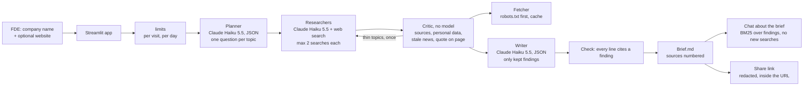

# Architecture

## System



## A brief, start to finish

```mermaid
sequenceDiagram
    actor U as FDE
    participant A as app.py
    participant P as Planner
    participant R as Researchers
    participant S as Web search
    participant C as Critic
    participant F as Fetcher
    participant W as Writer
    U->>A: "Club Med", clubmed.com
    A->>A: limits (visit, day)
    A->>P: company, website
    P-->>A: 6 questions (overview, properties, news, guest themes, tech, AI)
    loop each question, while under the cost cap
        A->>R: question
        R->>S: up to 2 searches
        S-->>R: results with citations
        R-->>A: sentences, each with the sources it overlaps
    end
    A->>C: findings
    C->>F: each cited page (robots.txt, cache)
    F-->>C: quote found / not found / robots.txt
    C-->>A: kept, removed, flagged
    opt topics with nothing usable, and budget left
        A->>R: re-research once with a hint
    end
    A->>W: kept findings only
    W-->>A: sections, 10 questions, 3 use cases, email
    A->>A: drop lines that cite nothing, render the brief
    A-->>U: brief, steps, cost; then chat and share
```

## Components

| Module | Job |
|---|---|
| `app.py` | Form, live step status, brief / steps / chat tabs, share link, shared view |
| `src/research/pipeline.py` | Orders the agents, records each step (input, result, time, cost), enforces the cost cap |
| `src/research/agents.py` | Planner, researcher (and sentence stitching), critic, writer, the writing check |
| `src/research/fetcher.py` | robots.txt-aware fetch, cache, quote check |
| `src/research/brief.py` | Markdown with numbered sources and the critic's report |
| `src/research/chat.py` | Answers from the findings only, follow-up rewrite, streamed |
| `src/research/share.py` / `pii.py` | Read-only links; redaction |
| `src/research/limits.py` | Briefs per visit, briefs and cost per day |
| `eval/run_eval.py` | Real and fictional companies, 3 runs, deterministic checks, re-score, labelling sample |

## Scaling path

1. Run the researchers in parallel (they're independent): about 2 minutes → about 30 seconds per brief.
2. Cache search results per company and day, so a second FDE asking about the same company pays nothing.
3. Store briefs (Postgres) with an owner, so a team can share and update them before a meeting.
4. A second search provider behind the same interface, for coverage and to compare citation quality.
